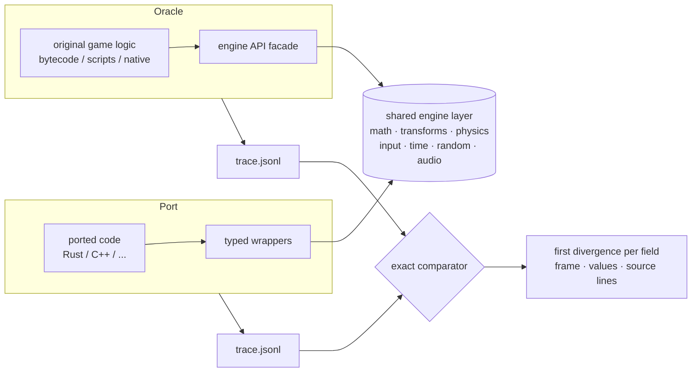

<div align="center">

# game-parity-port

**An AI agent skill for porting any game to a new language, with tick-exact proof that nothing changed.**

The original game is the test. Every field of every object is compared on every frame.

[](https://docs.claude.com/en/docs/claude-code/skills)
[](LICENSE)


**English** · [Русский](docs/README.ru.md)

</div>

---

## What it is

`game-parity-port` is a **skill**: a packaged method plus tools that an AI coding agent (Claude Code,
or any agent that reads `SKILL.md` skills) loads when you ask it to rewrite a game. It is not a
library and not a framework. It teaches the agent *how* to do the job and gives it the scripts to
check its own work.

The job: you have a game, any game, and you want it in Rust, C++, Zig, Go, anything,
**without breaking a single mechanic**.

The idea, borrowed from how emulators and engine ports are verified:

> Run the original game logic as an **oracle**, run the port on the same input, record every field of
> every object every tick, and compare them exactly. The first divergence tells you the frame, the
> field and the source line. No hand-written expectations, no screenshots, no "looks right".

Because the feedback is a precise report, the porting itself can be handed to **smaller, cheaper
models**: they port one class line by line, and the report tells them what is wrong.

## Works with any game

The method is the same everywhere; only the way the oracle is built differs. The skill has a recipe
for each kind of build and falls back to the generic method for anything else.

| Build | Oracle |
|---|---|
| Unity (Mono) · XNA / FNA / MonoGame · Godot C# | original .NET bytecode on a generated engine facade |
| Godot (GDScript) | original scripts on the real engine, headless |
| Java / Kotlin (LWJGL, libGDX) | original jars with a headless native layer |
| Lua · JavaScript / HTML5 · Python · Ruby · ActionScript | original scripts in the same VM |
| GameMaker | VM bytecode from `data.win`, or the instrumented YYC build |
| Unity (IL2CPP) · Unreal | instrumented original (hooks + recovered layouts / reflection) |
| Native C / C++, custom engines | rebuilt from source, hooked, or observed original |
| Console and retro (ROMs, DOS, SCUMM) | the emulator, with input movies and RAM maps |

The strongest form (original logic running on a facade) also enables **hybrid porting**: ported
pieces run inside the oracle on the live objects while everything else stays original, so each
class is verified alone, the moment it is written.

## How it works



1. **Split engine from game.** Engine behaviour is implemented once and shared, so only game logic is
   compared and engine differences do not drown the signal.
2. **Testing core first.** The agent builds the oracle, the trace and the comparator and must pass a
   gate check (determinism + a planted bug caught) before it writes a single line of the port.
3. **Run the original unchanged**, headless, fixed timestep, seeded, fed by scenario input.
4. **Trace everything**: every field of every object every tick, delta-encoded, with stable keys.
5. **Fixed, bot-recorded and randomized scenarios**: new random data every run, replayable by seed.
6. **Exact by default**: floats compared bit for bit. A tolerance hides real bugs.

## What is inside

```
game-parity-port/
├── SKILL.md                       method, architecture, phases with "done" criteria, rules for porting models
├── references/
│   ├── build-manual.md            the step-by-step procedure for the testing core, with real bugs and fixes
│   ├── oracle-examples.md         ready oracle harnesses: Python/pygame, browser JS, Lua/LÖVE, .NET, emulator
│   ├── recon.md                   identify the build; choose the oracle form
│   ├── oracle.md                  generic oracle: API inventory, facade, engine layer, frame loop, data
│   ├── trace-and-compare.md       trace format, stable keys, determinism and negative-control checks
│   ├── scenarios.md               fixed, bot-recorded and randomized scenarios
│   ├── porting-loop.md            hybrid bridge, coroutines, generated wrappers, who ports what
│   ├── live-and-standalone.md     play the hybrid live in a browser; run the port without the original
│   └── engines/                   unity-mono, unity-il2cpp, godot, dotnet-xna, unreal, jvm,
│                                  scripted, gamemaker, native, emulated
└── scripts/
    ├── gate_check.py              the gate: no porting until the testing core is proven trustworthy
    ├── trace_compare.py           language-agnostic exact comparator with source-line lookup
    ├── fuzz_scenario.py           randomized scenarios from an action table, reproducible by seed
    └── check.sh.template          one-command loop: build, oracle, hybrid, compare
```

## Install

Claude Code (personal skills):

```sh
git clone https://github.com/nanomolydev/game-parity-port.git
cp -r game-parity-port/game-parity-port ~/.claude/skills/
```

Or per project: copy the folder into `<project>/.claude/skills/`. Then describe the task in your own
words, for example:

> "I want to port my game to Rust and keep every mechanic identical. Set up the testing core."

The agent picks the skill up from its description; no command is needed.

The scripts also work on their own:

```sh
python3 game-parity-port/scripts/trace_compare.py oracle/trace.jsonl port/trace.jsonl --src game_src/ --out report/
python3 game-parity-port/scripts/fuzz_scenario.py base.json actions.json out.json        # prints the seed
```

## Example: a real port

The method was built and proven while porting a commercial 3D co-op game (Unity 2022.3, Mono, PhysX,
Photon) to Rust on a MacBook Air M2:

| | |
|---|---|
| oracle | the original game assembly running headless in .NET on a generated engine shim over a Rust engine layer |
| API inventory | 432 engine types and 753 members, generated from the real engine metadata |
| test scene | one room, a valuable item and a cart: 232 game classes, 68k lines of original code |
| ported so far | player movement (walk, sprint, crouch, slide, jump, stamina) and the full camera chain |
| verification | 0 divergences in 25.9 million values over 1500 frames, plus fresh randomized runs on every check |
| comparator self-test | a planted `+1e-6` in one field is reported at the right frame, with the declaring and assigning source lines |

No code or assets of that game are part of this repository.

## Who does what

| Small / cheap models | Big model or a human |
|---|---|
| line-for-line ports driven by the report | engine facade, engine layer, frame loop |
| new scenario files, fuzz action tables | trace format, comparator, bridge |
| fixing divergences the report points at | renderer, audio output, standalone runtime |

The porting rules are strict on purpose: never edit the oracle, the scenarios or the tolerances to
make a port pass. A smaller model can be wrong, but it cannot be wrong silently.

## Legal

Use it on games you own, for personal use, or on your own games. The oracle runs the original files
locally. Do not redistribute original code or assets inside a port, its test data or a public repo.

## About

A neural-network-native project: the method, the tools and this repository were designed and written
together with an AI agent ([Claude Code](https://claude.com/claude-code)) during a real port, and the
skill exists so that other agents can repeat it. Made by [nanomolydev](https://github.com/nanomolydev).
