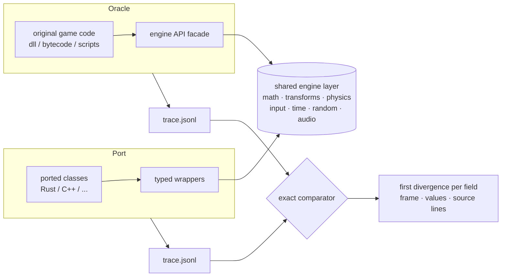

<div align="center">

# game-parity-port

**An AI agent skill for porting games to a new language with tick-exact proof that nothing changed.**

The original game is the test. Every field of every object is compared on every frame.

[](https://docs.claude.com/en/docs/claude-code/skills)
[](LICENSE)


[English](#what-it-is) · [Русский](#по-русски)

</div>

---

## What it is

`game-parity-port` is a **skill**: a packaged method plus tools that an AI coding agent (Claude Code,
or any agent that reads `SKILL.md` skills) loads when you ask it to rewrite a game. It is not a
library you call and not a framework you build on. It teaches the agent *how* to do the job and
gives it the scripts to check its own work.

The job: you have a game (Unity, Godot, a Java game, a Lua-scripted engine, your own C++ engine)
and you want it in Rust, C++, Zig, anything, **without breaking a single mechanic**.

The idea, borrowed from how console emulators and engine ports are verified:

> Run the original game code as an **oracle**, run the port on the same input, record every field of
> every object every tick, and compare them exactly. The first divergence tells you the frame, the
> field and the source line. No hand-written expectations, no screenshots, no "looks right".

Because the feedback is a precise report, the porting itself can be handed to **smaller, cheaper
models**: they port one class line by line and the report tells them what is wrong.

## How it works



1. **Split engine from game.** Engine-native behaviour is implemented once and shared, so only game
   logic is compared and engine differences do not drown the signal.
2. **Run the original unchanged.** For managed games (Unity Mono, .NET, Java, Lua, GDScript) the
   original bytecode runs headless on a generated engine facade. For native builds the oracle is an
   instrumented original.
3. **Hybrid porting.** Ported classes run *inside* the oracle on the live objects while everything
   else stays original, so each class is verified alone, the moment it is written.
4. **Fixed, bot-recorded and randomized scenarios.** New random data every run, replayable by seed.
5. **Exact by default.** Floats compared bit for bit. A tolerance hides real bugs.

## What is inside

```
game-parity-port/
├── SKILL.md                       method, architecture, phases with "done" criteria, rules for porting models
├── references/
│   ├── recon.md                   identify engine, backend, plugins; pick the oracle strategy
│   ├── oracle-unity-mono.md       full recipe for Unity Mono + the pitfalls that cost days
│   ├── trace-and-compare.md       trace format, stable keys, determinism and negative-control checks
│   ├── scenarios.md               fixed, bot-recorded and randomized scenarios
│   ├── porting-loop.md            hybrid bridge, coroutines, generated wrappers, model division of labour
│   ├── live-and-standalone.md     play the hybrid live in a browser; run the port without the original
│   └── other-engines.md           IL2CPP, Godot, Java, Lua/JS, native C++, Unreal
└── scripts/
    ├── trace_compare.py           engine-agnostic exact comparator with source-line lookup
    ├── fuzz_scenario.py           randomized scenarios from an action table, reproducible by seed
    └── check.sh.template          one-command loop: build, oracle, hybrid, compare
```

## Install

Claude Code (personal skills):

```sh
git clone https://github.com/nanomolydev/game-parity-port.git
cp -r game-parity-port/game-parity-port ~/.claude/skills/
```

Or per project: copy the folder into `<project>/.claude/skills/`. Then just describe the task:

> "I want to port my Unity game to Rust and keep every mechanic identical. Set up the testing core."

The agent picks the skill up from its description; no command is needed.

The scripts work on their own too:

```sh
python3 game-parity-port/scripts/trace_compare.py oracle/trace.jsonl port/trace.jsonl --src game_src/ --out report/
python3 game-parity-port/scripts/fuzz_scenario.py base.json actions.json out.json        # prints the seed
```

## Case study

The method was built and proven while porting a commercial Unity 2022.3 (Mono, PhysX, Photon)
co-op game to Rust on a MacBook Air M2:

| | |
|---|---|
| oracle | the original `Assembly-CSharp.dll` running headless in .NET on a generated UnityEngine shim over a Rust engine layer |
| API inventory | 432 engine types / 753 members generated from the real engine metadata |
| test scene | one room, a valuable, a cart: 232 game classes, 68k lines of original C# |
| ported so far | player movement (walk, sprint, crouch, slide, jump, stamina) and the full camera chain |
| verification | 0 divergences in 25.9 million values over 1500 frames, plus fresh randomized runs every check |
| comparator self-test | a planted `+1e-6` in one field is reported at the right frame with the declaring and assigning source lines |

No code or assets of that game are part of this repository.

## Who does what

| Small / cheap models | Big model or a human |
|---|---|
| line-for-line class ports driven by the report | engine facade, engine layer, player loop |
| new scenario files, fuzz action tables | trace format, comparator, bridge |
| fixing divergences the report points at | renderer, audio output, standalone runtime |

The porting rules are strict on purpose: never edit the oracle, the scenarios or the tolerances to
make a port pass. A smaller model can be wrong, but it cannot be wrong silently.

## Legal

Use it on games you own, for personal use, or on your own games. The oracle runs the original files
locally. Do not redistribute original code or assets inside a port, its test data or a public repo.

## About

A neural-network-native project: the method, the tools and this repository were designed and written
together with an AI agent ([Claude Code](https://claude.com/claude-code)) during a real port, and the
skill exists so that other agents can repeat it. Made by [nanomolydev](https://github.com/nanomolydev).

---

## По-русски

**game-parity-port** это скилл для ИИ-агентов (Claude Code и других, которые читают `SKILL.md`), а не
библиотека. Он учит агента переносить игру на другой язык (Rust, C++, ...) так, чтобы было доказано:
ни одна механика не изменилась.

Как это работает: оригинальный код игры запускается как эталон («оракул»), порт работает на том же
вводе, и каждое поле каждого объекта сравнивается на каждом тике без допусков. Первое расхождение
показывает кадр, поле и строку исходника. Поэтому переносить по отчёту могут даже небольшие модели:
ошибиться они могут, а ошибиться незаметно нет.

Установка: `cp -r game-parity-port/game-parity-port ~/.claude/skills/`, а дальше просто опиши задачу
агенту: «хочу переписать свою игру на Rust, чтобы всё было один в один».

Использовать только для своих или купленных игр, для себя. Оригинальный код и ассеты не
распространять.
