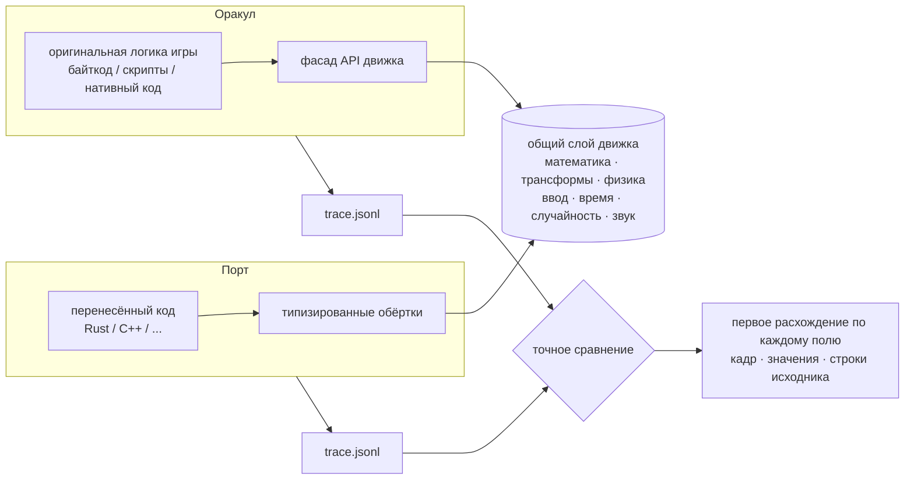

<div align="center">

# game-parity-port

**Скилл для ИИ-агентов: перенос любой игры на другой язык с потиковым доказательством, что ничего не изменилось.**

Тестом служит сама оригинальная игра. Каждое поле каждого объекта сравнивается на каждом кадре.

[](https://docs.claude.com/en/docs/claude-code/skills)
[](../LICENSE)


[English](../README.md) · **Русский**

</div>

---

## Что это

`game-parity-port` это **скилл**: упакованный метод и инструменты, которые ИИ-агент для
программирования (Claude Code или любой агент, читающий скиллы `SKILL.md`) подгружает, когда вы просите
его переписать игру. Это не библиотека и не фреймворк. Скилл учит агента, *как* делать эту работу, и
даёт ему скрипты, чтобы он сам проверял результат.

Задача: у вас есть игра, любая, и вы хотите получить её на Rust, C++, Zig, Go, на чём угодно,
**не сломав ни одной механики**.

Идея взята из того, как проверяют эмуляторы и порты движков:

> Оригинальная логика игры запускается как **оракул** (эталон), порт работает на том же вводе, каждое
> поле каждого объекта записывается на каждом тике, и записи сравниваются точно. Первое расхождение
> показывает кадр, поле и строку исходника. Никаких вручную написанных ожиданий, скриншотов и
> «вроде похоже».

Обратная связь здесь это точный отчёт, поэтому сам перенос можно поручить **небольшим и дешёвым
моделям**: они переносят класс построчно, а отчёт говорит им, где ошибка.

## Подходит для любой игры

Метод везде один, меняется только то, как собирается оракул. Для каждого типа сборки в скилле есть
рецепт, а для всего остального есть общий метод.

| Сборка | Оракул |
|---|---|
| Unity (Mono) · XNA / FNA / MonoGame · Godot C# | оригинальный .NET-байткод на сгенерированном фасаде движка |
| Godot (GDScript) | оригинальные скрипты на настоящем движке без окна |
| Java / Kotlin (LWJGL, libGDX) | оригинальные jar с безоконным нативным слоем |
| Lua · JavaScript / HTML5 · Python · Ruby · ActionScript | оригинальные скрипты в той же виртуальной машине |
| GameMaker | байткод VM из `data.win` или инструментированная сборка YYC |
| Unity (IL2CPP) · Unreal | инструментированный оригинал (хуки + восстановленные структуры / рефлексия) |
| Нативные C / C++, свои движки | оригинал, собранный из исходников, перехваченный хуками или наблюдаемый |
| Консоли и ретро (ROM, DOS, SCUMM) | эмулятор: записи ввода и карты памяти |

Самая сильная форма (оригинальная логика на фасаде) даёт ещё и **гибридный перенос**: перенесённые
части работают внутри оракула на живых объектах, а всё остальное остаётся оригиналом. Так каждый
класс проверяется отдельно, сразу как только написан.

## Как это работает



1. **Движок отдельно от игры.** Поведение движка реализуется один раз и общее для обеих сторон,
   поэтому сравнивается только логика игры, и различия движков не забивают сигнал.
2. **Сначала ядро тестов.** Агент строит оракул, трейс и сравнение и проходит барьерную проверку
   (детерминизм и пойманная подложенная ошибка) до того, как напишет хоть строку порта.
3. **Оригинал запускается без изменений**: без окна, с фиксированным шагом, с заданным seed, на вводе
   из сценария.
4. **Записывается всё**: каждое поле каждого объекта на каждом тике, дельтами, со стабильными
   ключами объектов.
5. **Фиксированные, записанные ботом и случайные сценарии**: каждый запуск на новых данных,
   воспроизводимо по seed.
6. **Точно по умолчанию**: числа сравниваются бит в бит. Допуск прячет настоящие ошибки.

## Что внутри

```
game-parity-port/
├── SKILL.md                       метод, архитектура, этапы с критериями «готово», правила для моделей
├── references/
│   ├── build-manual.md            пошаговая сборка ядра тестов, с реальными поломками и их исправлением
│   ├── oracle-examples.md         готовые обвязки оракула: Python/pygame, JS в браузере, Lua/LÖVE, .NET, эмулятор
│   ├── recon.md                   как распознать сборку и выбрать форму оракула
│   ├── oracle.md                  общий оракул: перечень API, фасад, слой движка, цикл кадра, данные
│   ├── trace-and-compare.md       формат трейса, стабильные ключи, проверки детерминизма и подложенной ошибки
│   ├── scenarios.md               фиксированные, записанные ботом и случайные сценарии
│   ├── porting-loop.md            гибридный мост, корутины, генерируемые обёртки, кто что переносит
│   ├── live-and-standalone.md     живая игра в браузере; запуск порта без оригинала
│   └── engines/                   unity-mono, unity-il2cpp, godot, dotnet-xna, unreal, jvm,
│                                  scripted, gamemaker, native, emulated
└── scripts/
    ├── gate_check.py              барьер: никакого переноса, пока ядро тестов не доказало надёжность
    ├── trace_compare.py           точное сравнение трейсов для любого языка, с поиском строк исходника
    ├── fuzz_scenario.py           случайные сценарии по таблице действий, воспроизводимые по seed
    └── check.sh.template          проверка одной командой: сборка, оракул, гибрид, сравнение
```

Сам скилл написан на английском: так его одинаково понимают любые модели. Отвечать вам агент будет
на вашем языке.

## Установка

Claude Code (личные скиллы):

```sh
git clone https://github.com/nanomolydev/game-parity-port.git
cp -r game-parity-port/game-parity-port ~/.claude/skills/
```

Или для одного проекта: скопируйте папку в `<проект>/.claude/skills/`. Дальше просто опишите задачу
своими словами, например:

> «Хочу переписать свою игру на Rust, чтобы все механики были один в один. Собери ядро тестирования.»

Агент сам подхватит скилл по описанию, команда не нужна.

Скрипты работают и сами по себе:

```sh
python3 game-parity-port/scripts/trace_compare.py oracle/trace.jsonl port/trace.jsonl --src game_src/ --out report/
python3 game-parity-port/scripts/fuzz_scenario.py base.json actions.json out.json        # печатает seed
```

## Пример: настоящий порт

Метод создан и проверен на переносе коммерческой 3D-кооперативной игры (Unity 2022.3, Mono, PhysX,
Photon) на Rust на MacBook Air M2:

| | |
|---|---|
| оракул | оригинальная сборка игры, запущенная без окна в .NET на сгенерированном шиме движка поверх слоя движка на Rust |
| перечень API | 432 типа и 753 члена движка, сгенерированы из метаданных настоящего движка |
| тестовая сцена | одна комната, ценный предмет и тележка: 232 класса игры, 68 тыс. строк оригинального кода |
| уже перенесено | движение игрока (ходьба, бег, присед, подкат, прыжок, выносливость) и вся цепочка камеры |
| проверка | 0 расхождений на 25,9 млн значений за 1500 кадров, плюс новые случайные прогоны на каждой проверке |
| самопроверка сравнения | подложенная ошибка `+1e-6` в одном поле находится на нужном кадре, вместе со строками, где поле объявлено и присваивается |

Кода и ассетов этой игры в репозитории нет.

## Кто что делает

| Небольшие и дешёвые модели | Большая модель или человек |
|---|---|
| построчный перенос по отчёту | фасад движка, слой движка, цикл кадра |
| новые сценарии, таблицы случайных действий | формат трейса, сравнение, мост |
| исправление расхождений, на которые указал отчёт | рендер, вывод звука, запуск без оригинала |

Правила переноса строгие специально: нельзя менять оракул, сценарии или допуски, чтобы порт прошёл
проверку. Небольшая модель может ошибиться, но не может ошибиться незаметно.

## Правовое

Используйте для игр, которые у вас куплены, для себя, или для своих игр. Оракул запускает
оригинальные файлы локально. Не распространяйте оригинальный код и ассеты в составе порта, тестовых
данных или публичного репозитория.

## О проекте

Нейропроект: метод, инструменты и этот репозиторий спроектированы и написаны вместе с ИИ-агентом
([Claude Code](https://claude.com/claude-code)) на настоящем порте, а скилл нужен, чтобы другие агенты
могли это повторить. Автор: [nanomolydev](https://github.com/nanomolydev).
